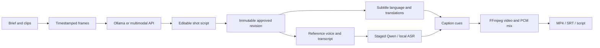

# Architecture

The app runs one local FastAPI service with bundled static assets. It needs no JavaScript build or cloud account for the local model path.

## Modules and contracts

- `domain.py`: validated source ranges, scene schema and canonical JSON hashing.
- `store.py`: SQLite transactions, project epochs, immutable approved revisions and durable jobs. Every user edit advances an epoch. Publication checks the captured epoch and cancellation flag in the same transaction.
- `jobs.py`: one worker thread; model, ASR and FFmpeg subprocesses run sequentially. Interrupted jobs are marked on restart and are explicitly retried against current inputs.
- `providers.py`: cancellable HTTP requests, image serialization, finite schema retries, scene and translation validation. Remote errors hide response bodies/credentials.
- `media.py` / `captions.py`: content-based imports, ffprobe, frame sampling, reference preprocessing, Pillow captions, PCM mixing, H.264/AAC rendering and full decode validation.
- `models.py`: pinned model manifests and streamed byte-identical safetensors subsets.
- `voice.py` / `workers/`: isolated heavy imports, staged reference encoder / talker / decoder, official experimental torch adapter, local CPU ASR, complete cache identities.
- `alignment.py`: English word and Chinese character normalization, transcript coverage checks, pause boundaries and caption cue timing.
- `api.py`: loopback web API, trusted hosts, same-origin token checks, bounded uploads and registered-file downloads.

## Content and cache identity

Media IDs derive from SHA-256, not filenames. The approved revision covers project identity, language and the entire scene list. TTS cache keys include full text, reference audio hash, corrected reference transcript, model/revision, generation parameters and complete narration context. Caption edits do not alter narration. Video artifacts refer to the job's immutable snapshot and are exposed only after validation and a successful epoch check.

On MLX, model tensors are verified against the pinned checksums. Component files retain the original tensor bytes; the large text embedding is read by selected rows. Speech waveform decoding uses bounded chunks with reference context. The native model operations come from MLX-Audio; private experimental fixtures are not part of the package.

## Process ownership and memory

Each process is started without a shell. POSIX process groups or Windows child-process traversal limit cancellation to job-owned processes. Preflight checks memory and disk. A live watchdog observes process RSS, available system memory, swap growth and runtime. Protection stops the current stage and makes the task explicitly retryable. The app does not terminate unrelated applications.

Ollama is a separately managed local service. Requests use `keep_alive: 0` to release model residency and are cancellable at the HTTP connection. Do not run another external workload concurrently when memory is constrained.

## Testing boundary

Public tests synthesize clips/audio and substitute only slow model operations. They still run real domain validation, SQLite state, HTTP serialization and FFmpeg. Real-model testing uses private inputs outside the repository and is documented separately. Speaker similarity is a listening judgment, not an ASR score.
